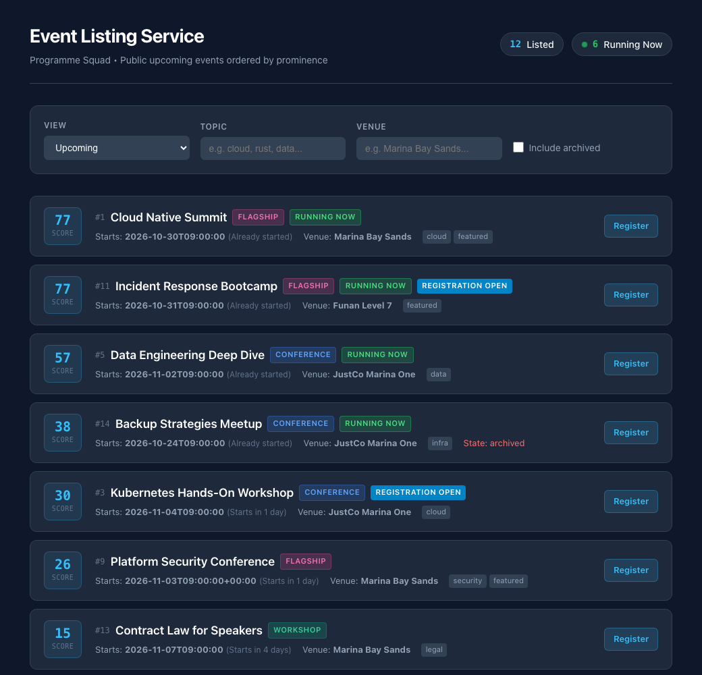
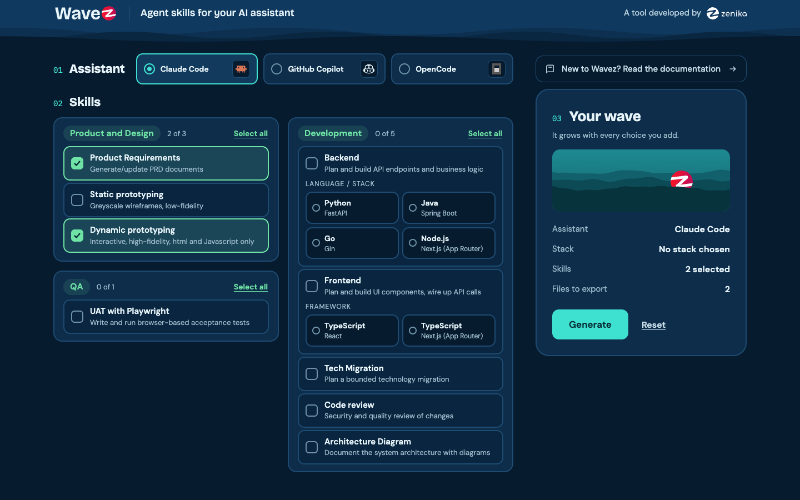
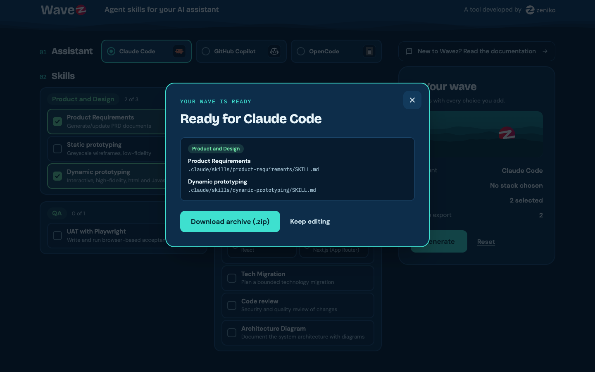
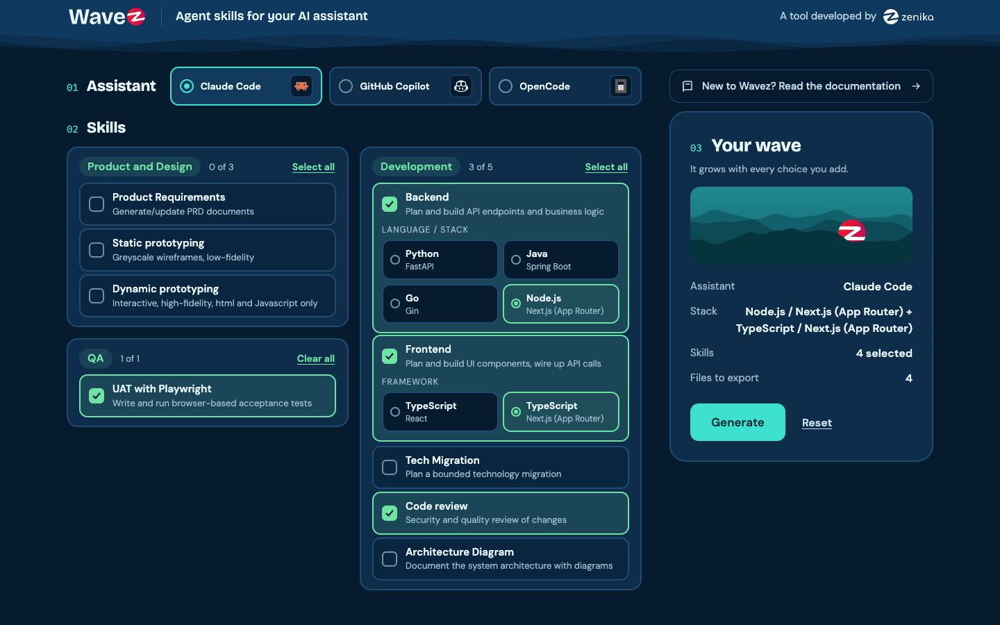
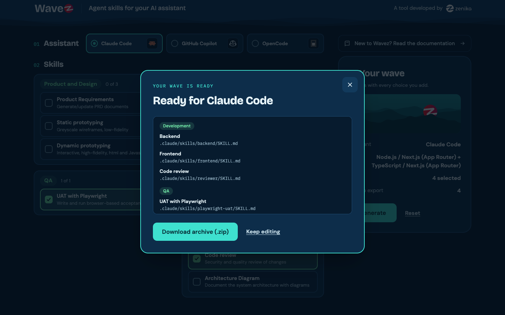

= AI-Driven Development with Claude - Lab instructions
:data-uri:
:toc: left
:toclevels: 2
:docinfo: shared
:source-highlighter: rouge
:rouge-style: monokai
:repo-url: https://github.com/zenika-dev/sg-stack-workshop.git

++++

++++

* Prerequisites: you should have the following installed:

** Git. See https://git-scm.com/install/[here,window="_blank"] for more details.
** https://nodejs.org/en/download[Node.js 24 or later,window="_blank"]
** https://code.visualstudio.com/download[Visual Studio Code,window="_blank"] (version 1.140 or later recommended)
** the *Claude Code* command line (CLI). Run `claude --version` in a terminal. If the command is not found, install it with `curl -fsSL https://claude.ai/install.sh | bash` (macOS, Linux, WSL) or `irm https://claude.ai/install.ps1 | iex` (Windows PowerShell). See https://code.claude.com/docs/en/setup[here,window="_blank"] for more details.
** a *Claude account* (Pro, Max, Team or Enterprise). If you do not have one, please reach out to your instructor.

== Overview

Your team has just inherited the *Event Listing Application*: a conference ranking app (Next.js, React, TypeScript, SQLite) that lists upcoming tech events and gives each one a prominence score, depending on the kind of event and when it takes place. Nobody currently on the team wrote it, and nobody has set it up for AI-assisted development yet.

Two pieces of work are waiting for you: a *new feature* (there is no screen to add or edit events, they are entered directly into the database) and a change to an *existing feature* (the public listing page is confusing, and its search does not find the events attendees expect).

[cols="2,3,3",options="header"]
|===
| Section | What you do | Skills
| *1. Get started* | Clone the repository, run the application and explore its listing page | -
| *2. Specs* (new feature) | Turn a request into a validated PRD for the event management feature | `product-requirements`, `dynamic-prototyping`
| *3. Implementation* (new feature) | Implement the PRD, review it and test it | `backend`, `frontend`, `reviewer`, `playwright-uat`
| *4. Specs + Implementation* (existing feature, *optional*) | Write the spec of the listing page change from the code, then implement and test it with the same flow as Section 3 | Claude Code, then the skills of Section 3
|===

[discrete]
=== The repository

[source,text]
----
sg-stack-workshop/
├── 01-product-management/            Section 2: the product management workspace
│   ├── current-app/                  the listing page today: screenshot, HTML and stylesheet
│   └── data/events-export.csv        the events currently in the database
└── 02-application/
    └── event-listing-service/        Sections 3 and 4: the application workspace
        ├── app/, components/, hooks/   Next.js pages, API routes and React UI
        ├── lib/                        event ranking and SQLite database
        ├── tests/                      Vitest tests
        └── SPEC.md                     the original spec of the listing page
----

You will open each workspace in its own VS Code window, and install the skills that each one needs.

[discrete]
=== Wavez

The skills you will use come from https://wavez.org/[Wavez,window="_blank"]. Wavez is an open source tool from Zenika (Apache 2.0, https://github.com/zenika-open-source/Wavez[source on GitHub,window="_blank"]) that sets your AI assistant up to work the way a good team does: you pick your assistant and the skills you need, and Wavez generates the files that teach it how to write requirements, build prototypes, implement and review code, and run tests.

== 1. Get started: run the application

Before you change anything, you get to know the application the way its users see it: you clone it, run it and explore its listing page.

=== 1.1 Clone the repository

* From a terminal window, clone the repository below into your local file system:

[source,shell,subs="attributes"]
----
git clone {repo-url}
----

* In VS Code, select *File > Open Folder...* and open the `sg-stack-workshop/02-application/event-listing-service` folder. This is the application workspace: you will come back to it in Sections 3 and 4.

=== 1.2 Run the application

* Open the integrated terminal (*Terminal > New Terminal*) and run the following commands from the `02-application/event-listing-service` folder:

[source,shell]
----
node --version
npm install
npm test
----

* `node --version` should show `v24` or later, and the tests should pass.
* Run `npm run dev` and open http://localhost:3000[window="_blank"]. Keep this terminal running: it is your application terminal.

=== 1.3 Explore the application

* Take a few minutes to check out the listing page: the event cards, the filters and the search.

* Keep the application running and this VS Code window open.

== 2. Specs: event management (new feature)

The engineering team receives a request: *the Events Coordinator wants to add and edit events*. In this section, you wear the *Product Manager* hat: you turn the request into a validated specification (Product Requirement Document).

=== 2.1 Open the product management workspace

* In VS Code, select *File > New Window*, then *File > Open Folder...* and open the `sg-stack-workshop/01-product-management` folder.

=== 2.2 Get the Product and Design skills from Wavez

* Open https://wavez.org/[Wavez,window="_blank"] in your browser.
* In *01 Assistant* (first row), select *Claude Code*.
* In *02 Skills*, in *Product and Design*, tick `Product Requirements` and `Dynamic prototyping`.

* Click *Generate*. The *Ready for Claude Code* window lists the 2 skill files. Confirm by clicking *Download archive (.zip)*. Your browser downloads a file named `wavez-setup.zip`.

* Unpack `wavez-setup.zip` inside the `01-product-management` folder, and check in the VS Code Explorer that you now have:

[source,text]
----
01-product-management/
├── .claude/
│   └── skills/
│       ├── product-requirements/
│       │   └── SKILL.md
│       └── dynamic-prototyping/
│           └── SKILL.md
├── current-app/
│   ├── listing-page.png
│   ├── listing-page.html
│   └── globals.css
└── data/
    └── events-export.csv
----

* Check that Claude Code finds the new skills:
** Open the integrated terminal (*Terminal > New Terminal*) and run `claude`. Sign in with your Claude account if prompted, and confirm that you trust the folder.
** Type `/`: you should see `/product-requirements` and `/dynamic-prototyping` in the list.

=== 2.3 Create requirements brief

* Run `/clear` to start a new conversation and send:

NOTE: `/clear` empties Claude's memory of the current conversation. Each step starts from a clean context, so earlier prompts and files do not influence the result, and the session stays fast and focused. It also saves tokens, because Claude no longer re-reads the old conversation with every message. Your files on disk are not affected.

[source,text]
----
Create the file 01-knowledge/requirements-brief.md from the stakeholder notes below.
Use only what is written in the notes: do not invent requirements.

Structure:
1. Context: the product, its users, how events are managed today
2. Problems: each pain point and its impact
3. Requested feature: what the Events Coordinator must be able to do
4. Known rules and constraints
5. Out of scope
6. Open questions: what the notes do not say and the PRD must decide (8 at most)

STAKEHOLDER NOTES
- Product: the Event Listing Application, a public page listing upcoming tech community events (meetups, workshops, conferences, flagship events), ranked by a prominence score. Our team inherited it; nobody on the team wrote it.
- User: the Events Coordinator of the Programme squad. Not technical. Manages the events sent by about 40 external organisers.
- Today there is no screen to add or edit events. The coordinator sends a spreadsheet to an engineer, who inserts the events directly into the database. It takes 2 to 3 days, and every correction (new venue, new date, cancellation) goes through the same loop.
- Nothing checks the spreadsheet, so mistakes reach the database: dates in the wrong format, events with no date, a date typed as "sometime next week".
- Request: add and edit events directly from the existing listing page, without an engineer: an "Add event" button in the page header and an "Edit" button on each event card, both opening a modal. Invalid data must be refused before it is saved.
- Event fields today: title, kind, status, start date and time, topics, venue, embargoed until (the event is held back until the organiser's official announcement), archived flag, created date.
- The listing page keeps its current look: the new buttons and the modal follow its existing style.
- Out of scope: any other change to the listing page, its filters and its ranking.
----

[.why]
====
*Why this prompt?*

* *The notes, pasted into the prompt:* Claude has never heard of this request: everything it writes must come from them.
* *"Do not invent requirements":* otherwise Claude fills the gaps with plausible requirements that nobody asked for.
* *Open questions, in a file:* the gaps become explicit questions, and the brief becomes the source of truth that later prompts attach with `@`.
====

* Open `01-knowledge/requirements-brief.md` and read the open questions: the `product-requirements` skill will ask you about some of them.

=== 2.4 Create Product Requirement Document (PRD)

* Run `/clear` to start a new conversation and send:

[source,text]
----
Use the product-requirements skill to create a product requirements document based on the attached brief @01-knowledge/requirements-brief.md

CONTEXT: the Event Listing Application already exists; its listing page is shown in @current-app/listing-page.png. Today, events can only be added or changed directly in the database by an engineer. This is a new feature added to the existing page, not a new application.

EVENT MANAGEMENT: on the existing listing page, an "Add event" button in the page header and an "Edit" button on each event card. Adding and editing happen in a modal with these fields: title, kind, status, start date and time, topics, venue, embargoed until, archived. At least one requirement must describe how invalid data is prevented from being saved, with one validation rule per field that prevents the bad data described in the brief.

OUT OF SCOPE: any other change to the listing page, its filters and its ranking.

USER STORIES: write stories for the Events Coordinator: add an event, correct an event, have invalid data refused, and set the embargo date and the archived flag.
----

[.why]
====
*Why this prompt?*

* *The `product-requirements` skill:* brings the method (sections, user stories, acceptance criteria) and asks you about what the brief leaves unclear.
* *`@...requirements-brief.md`:* grounds the PRD in the brief, not in Claude's general idea of an events application.
* *`@current-app/listing-page.png`, "not a new application":* without them, Claude would design a new admin screen.
* *Modal, validation rules, out of scope, user stories:* decisions already made. Stating them stops the PRD from reopening or extending them.
====

* Answer the skill's questions based on the brief. When the brief says nothing, make a decision and say so.
* Open the generated `02-product-requirements/{name-of-feature}-prd.md` and check it: are the buttons and the modal on the existing listing page? Does every field have a validation rule? Edit the file or ask Claude to change it.

NOTE: When it finishes, the skill may suggest building static, greyscale mock-ups as the next step. This lab skips them and goes straight to a clickable prototype of the feature, in the next step.

=== 2.5 Build a dynamic prototype

A PRD is hard to judge on paper. Before handing it to the developers, you test it with a clickable prototype of the current listing page plus the new feature. Problems found now cost a PRD update; found after implementation, they cost code changes.

* Run `/clear` to start a new conversation and send:

[source,text]
----
Use the dynamic-prototyping skill. I am building a prototype of a new feature for an existing application, and need first to create a script called eventStore.js, saved as 05-dynamic-prototyping/eventStore.js, which will hold the events.

What the file is for
The Events Coordinator adds and edits events from the listing page. The file should load the initial events, validate every event that is added or edited, and give the rest of the prototype the list of events to display.

The initial events
Load the 15 events from @data/events-export.csv and embed them in the file, so that the prototype works without uploading anything. Keep them as they are, including the ones with bad data.

What I need the file to do
Validate an event before saving it, using the validation rules from the PRD @02-product-requirements. If an event is invalid, return a clear message for each field in error.
Keep added and edited events in memory while the prototype is open.

The functions the rest of the prototype will call are named getEvents, saveEvent and validateEvent.
----

[.why]
====
*Why this prompt?*

* *The `dynamic-prototyping` skill:* plain HTML and JavaScript, no build tools: quick to create, thrown away after the test.
* *`@data/events-export.csv`:* real events, bad data included, so the prototype faces the real problems.
* *The validation rules from `@02-product-requirements`:* the prototype applies the PRD's rules, so testing the prototype tests the PRD.
* *Named functions in a separate file:* data and validation come first; the next prompt builds the screens on them.
====

* In the *same* conversation, send the build brief below:

[source,text]
----
Event Listing Application — Add / edit events prototype
Build the prototype as 05-dynamic-prototyping/index.html. The file eventStore.js already exists in the same folder. Use its functions for all data and validation.

Current listing page (do not redesign it)
Recreate the current listing page exactly, from @current-app/listing-page.html (markup), @current-app/globals.css (styles) and @current-app/listing-page.png (how it looks). Keep the header, the filters and the event cards as they are.
Show the events from eventStore.js in the same order as the snapshot. Events that the snapshot does not show stay hidden.
The filters and the "Register" button do not need to work.

New feature (the only change to the page)
An "Add event" button in the page header, next to the counters
An "Edit" button on each event card, next to "Register"
Both open an add / edit modal over the page, titled "Add event" (empty) or "Edit event" (pre-filled)
The modal follows the existing style of the page: colours, fonts, inputs and buttons from globals.css
Every field from the PRD, with a date and time picker for dates (no free text) and an "Archived" switch
"Save" and "Cancel" buttons; Cancel and the Escape key close the modal without saving
When the user clicks "Save", show a message under each invalid field and keep the modal open; nothing is saved while there are errors
On save, close the modal, show a short confirmation and highlight the saved card. A new event is added at the top of the list with "-" as its score: the prototype does not calculate scores.

When you are done, give me a short list of every assumption you made that the PRD did not specify.
----

[.why]
====
*Why this prompt?*

* *The same conversation:* `eventStore.js` and the PRD are still in Claude's context: no need to attach them again.
* *`@current-app/...`:* the prototype looks like the real application, so users react to the new feature, not to a new design.
* *"The only change to the page", "does not calculate scores":* keep the prototype within the PRD's scope.
* *"Every assumption you made":* Claude decides whatever the PRD does not say. Listing these decisions turns hidden choices into questions for the user.
====

* Copy Claude's list of assumptions into a new file `01-knowledge/prototype-notes.md`.
* Open `05-dynamic-prototyping/index.html` (right-click > *Open in Integrated Browser*, or in your usual browser).
* Test the scenarios below. Ask Claude to fix what is wrong, and add your findings to `01-knowledge/prototype-notes.md`:
. Compare the prototype with `current-app/listing-page.png`. Apart from the new buttons, does the page look the same?
. Add a workshop titled "Intro to Kubernetes" starting on 5 March 2026. Does it appear as a highlighted card after saving?
. Try to save an event with no start date. Is it refused with a clear message under the field, with the modal still open?
. Set an embargo date *after* the start date. Is it refused with a message that explains why?
. Edit "Contract Law for Speakers", change its venue to "Funan Level 7" and save. Does the card show the new venue? Open *Edit* again and press Escape: does the modal close without changes?

=== 2.6 Get feedback and update the PRD

You do not have the Events Coordinator in the room: Claude plays them. A role-play does not replace a real user, but it finds the obvious problems first.

* Take two screenshots: the listing page with the new buttons, and the modal showing validation messages.
* Run `/clear`, add both screenshots to your message (copy a screenshot and press *Ctrl+V*, also on macOS, or drag the image file into the terminal) and send:

[source,text]
----
Act as the Events Coordinator described in @01-knowledge/requirements-brief.md. You are not technical, under time pressure and direct. Stay in character.

We have built a first version of the add / edit feature: the screenshots show the listing page with the new "Add event" and "Edit" buttons, and the add / edit modal.

Tell me:
1. Could you add and correct events on your own with this? What is missing or confusing?
2. Would the validation messages stop the mistakes that reach the database today? Which ones would still get through?
3. Here are some decisions we made while building it. What would you expect instead?
[paste 3 assumptions from 01-knowledge/prototype-notes.md]

Then save your answers in 01-knowledge/prototype-feedback.md.
----

[.why]
====
*Why this prompt?*

* *The screenshots:* Claude sees what the user would see, not the code.
* *The brief and "stay in character":* the persona comes from the brief, so the feedback is grounded in the real user.
* *Three of your assumptions:* feedback on the decisions the PRD did not cover, before developers build them.
====

* Ask follow-up questions in the same conversation if needed.
* Run `/clear` to start a new conversation and send:

[source,text]
----
Use the product-requirements skill to update the product requirements document @02-product-requirements based on what we learnt from the prototype:
- User feedback: @01-knowledge/prototype-feedback.md
- Assumptions and test findings: @01-knowledge/prototype-notes.md

For each point, either add or update a requirement, or record it as an open question.
Make sure every user story has acceptance criteria in Given/When/Then format.
Add a "Changes since v1" section at the end of the document.
----

[.why]
====
*Why this prompt?*

* *The feedback and the notes attached with `@`:* every change comes from evidence, not from a new idea of Claude's.
* *"Add or update a requirement, or record it as an open question":* no point is dropped silently.
* *"Changes since v1":* developers can see what changed, and why.
====

* Check that each change in "Changes since v1" traces back to the feedback, an assumption or a test finding.
* If you're happy with the output, the PRD is ready to be implemented.

== 3. Implementation: event management (new feature)

You now switch hats: you are the developer who implements the PRD with the `backend`, `frontend`, `reviewer`, then `playwright-uat` skills. Each development skill writes a plan in `docs/plans/`, waits for your approval, implements it step by step and ends with a *Handover* block for the next skill.

=== 3.1 Go back to the application

* Go back to the `event-listing-service` VS Code window from Section 1 (if you closed it, select *File > Open Recent*). Keep the product management window open: you will need its PRD in step 3.3.
* Check that the application still runs at http://localhost:3000[window="_blank"]. If it does not, run `npm run dev` in the integrated terminal. Keep this terminal running: it is your application terminal.

=== 3.2 Get the Development and QA skills from Wavez

* Go back to https://wavez.org/[Wavez,window="_blank"] and select *Claude Code* again. Untick any skill still selected from Section 2.
* Tick the following 4 skills:
** *Development*: `Backend`, `Frontend` and `Code review`. Under `Backend`, select *Node.js* (Next.js App Router); under `Frontend`, select *TypeScript* (Next.js App Router): the stack of this application.
** *QA*: `UAT with Playwright`

* Click *Generate*. The *Ready for Claude Code* window lists the 4 skill files. Confirm by clicking *Download archive (.zip)*.

* Unpack the new `wavez-setup.zip` inside the `event-listing-service` folder, and check in the VS Code Explorer that you now have:

[source,text]
----
event-listing-service/
├── .claude/
│   └── skills/
│       ├── backend/            SKILL.md + references/architecture.md
│       ├── frontend/           SKILL.md + references/architecture.md
│       ├── reviewer/           SKILL.md + references/ + scripts/
│       └── playwright-uat/     SKILL.md + templates/
├── app/
├── lib/
└── package.json
----

Each skill's `references/architecture.md` holds the rules its plans follow.

* Open a second terminal (`+` icon in the terminal panel) and run `claude`, as in step 2.2: this is your Claude Code terminal. Type `/`: you should see `/backend`, `/frontend`, `/reviewer` and `/playwright-uat` in the list.

=== 3.3 Hand over the PRD and run a gap analysis

* Open a third terminal (`+` icon in the terminal panel) for the other commands, and copy the PRD into the application:

[source,shell]
----
mkdir -p docs/product
cp ../../01-product-management/02-product-requirements/*.md docs/product/
----

TIP: If you did not finish Section 2, copy the reference PRD `event-management-prd.md` provided by your instructor into `docs/product` instead.

* Run `/clear`, press *Shift+Tab* until *plan mode on* shows below the prompt, and send:

[source,text]
----
Read the PRD in docs/product. For each requirement, tell me in a table whether the application already implements it, partially or not at all, and which files are concerned. Do not change any code.
----

[.why]
====
*Why this prompt?*

* *The PRD in `docs/product`:* part of the application repository, where every later prompt and skill can find it.
* *Plan mode:* Claude reads but changes nothing. You see the size of the work, and what already exists, before any code is written.
====

* Review the table: it tells you what the rest of this section will change. Press *Shift+Tab* until *auto mode on* shows below the prompt.

TIP: In auto mode, Claude edits files and runs commands on its own, and stops only for actions it judges risky. If you prefer to approve every change yourself, press *Shift+Tab* until manual mode: Claude asks before each edit or command and shows you what it wants to do, and you accept or reject it. It is slower, but you see every change as it happens.

=== 3.4 Implement the backend

You start with the server side: the API that reads, creates and updates an event, and applies the validation rules of the PRD. The `backend` skill first writes a plan for you to approve, then implements it and runs the tests.

* Run `/clear` to start a new conversation and send:

[source,text]
----
Use the backend skill in Plan mode: produce a Feature Plan for the event management feature described in docs/product, backend only.
- API to get one event, create an event and update an event
- apply every validation rule of the PRD; an invalid event must be refused with one clear message per invalid field
- every field of the modal must be saved: title, kind, status, start date and time, topics, venue, embargoed until, archived
- the existing listing and ranking must keep working unchanged
- the testing plan must cover each acceptance criterion of the PRD
----

[.why]
====
*Why this prompt?*

* *What, not how:* the skill and the existing code give the *how*. The prompt only says what to build and what must not break.
* *Tests for each acceptance criterion:* they prove that the PRD is met, not only that the code runs.
* *"Stop after each step"* (approval prompt below): you review small changes instead of one large one.
====

* Open the plan in `docs/plans/`. Is every validation rule of the PRD in its *API Contract* table? Iterate with the skill until you are satisfied.
* Approve the plan:

[source,text]
----
The plan is approved. Implement mode: implement it step by step, and stop after each step for my validation.
----

* Check that the `### Backend Handover` block shows `PASS`, then run `npm test` in your third terminal.
* With a curl command from the handover, create an event with no start date. Is it refused with a clear message?

=== 3.5 Implement the frontend

Next, the screen: the "Add event" and "Edit" buttons and the add / edit modal on the listing page, connected to the API you just built. The `frontend` skill works the same way: plan, approval, then implementation.

* In the *same* conversation, send:

[source,text]
----
Use the frontend skill in Plan mode: produce a Frontend Plan for the event management feature described in docs/product, using the API contract from the Backend Handover above.
- an "Add event" button in the header of the listing page and an "Edit" button on each event card
- an add / edit modal in the existing style of the page, showing the validation messages returned by the API under each field
- the rest of the listing page does not change
----

[.why]
====
*Why this prompt?*

* *The same conversation:* the `frontend` skill needs the Backend Handover, the API contract. It is already in the context, so the frontend calls the API exactly as it was built.
* *Buttons, existing style, the rest unchanged:* the same scope as the PRD and the prototype.
====

* Review, approve and implement the plan as you did for the backend.
* On http://localhost:3000, add an event starting in 3 days from *today*, correct its venue, then try to save it with no start date. Does each step behave as the PRD says?

=== 3.6 Review the changes

Before you commit, a second pair of eyes: the `reviewer` skill checks the backend and frontend changes for security and quality issues, and checks that they meet the PRD. It gives a verdict and a list of issues to fix.

* In the *same* conversation, send:

[source,text]
----
Use the reviewer skill to review all uncommitted changes for the event management feature, using the Backend Handover and Frontend Handover above. Check them against the PRD in docs/product.
----

NOTE: Do not confuse the `reviewer` skill with Claude Code's built-in `/code-review` command.

[.why]
====
*Why this prompt?*

* *A separate skill, with both handovers:* the work is checked independently of the skills that wrote it, knowing what changed and why.
* *"Check them against the PRD":* the review checks that the request is met, not only the style of the code.
====

* Read the verdict (🟢 APPROVE, 🟡 REQUEST CHANGES or 🔴 BLOCK). Fix the blocking issues with the `backend` or `frontend` skill, run `npm test`, then commit your changes.

=== 3.7 Run the acceptance tests

Last, you check the feature the way the Events Coordinator will use it: in a browser, against each acceptance criterion of the PRD. The `playwright-uat` skill works in two phases: it first writes a test plan for you to review, then runs it in a real browser and produces a Word (`.docx`) report.

* Make sure that the application is running (`npm run dev` in your application terminal). Do not run `npm test` while the UAT runs: it would reset the database.
* Run `/clear` to start a new conversation and send:

[source,text]
----
Use the playwright-uat skill to plan UAT for the event management feature, based on the user stories and acceptance criteria of the PRD in docs/product. Persona: Events Coordinator.
----

[.why]
====
*Why this prompt?*

* *The user stories and acceptance criteria:* the tests check what was asked, written before the code.
* *The persona:* the tests act as the Events Coordinator, through the screens.
====

* Open the generated `*_MANUAL_TEST_PLAN.md` (next to the PRD). Does every acceptance criterion have a test case? Then run it:

[source,text]
----
The test plan is approved. Run UAT on http://localhost:3000 and generate the execution report.
----

[.why]
====
*Why this prompt?*

* *"The test plan is approved":* the skill runs only the plan you reviewed, on the real application. The report and its screenshots are the evidence that the request is met.
====

* Allow the commands the skill asks to run: it installs Playwright if needed, runs every test case and takes screenshots.
* Open `*_Test_Execution_Report.docx` (in `references/`, next to the test plan). If a test fails, ask Claude whether the problem is in the application or in the PRD, and fix it with the right skill.
* Commit the test plan and the report. You have taken a feature from a request to a tested implementation, congratulations!

== 4. Specs + Implementation: listing page and search (existing feature, optional)

The Programme squad reports that attendees find the public listing page confusing, and that its search does not find the events they expect (the full requirement is in the prompt below). This section covers both jobs on a smaller scale: first the spec, then the implementation. Stay in the application workspace.

=== 4.1 Write the spec from the code

This step is *product management* work, as in Section 2: the outcome is a spec, not code. For a new feature, the knowledge came from the user and a prototype. For an existing feature, it comes first from the code: Claude reads and explains it, then you decide what must change.

* Run `/clear` to start a new conversation and send the prompt below:

[source,text]
----
The Programme squad sent this requirement for the public listing page of this application:
"Attendees find the public listing page confusing: they do not understand the score shown on each card, what "Running now" means, or why the "Register" button does not register them anywhere. They also tell us that searching by topic or venue does not find the events they expect. Make the page clearer and fix the search, without changing the order in which events are ranked."

Analyse the code (API routes, lib, components, hooks, tests) and SPEC.md, then write docs/specs/listing-page-spec.md with:
1. Current behaviour: how events are selected, ranked, counted and searched today, in plain English, with file references. Mark every place where the code and SPEC.md disagree.
2. Root causes of the search problem, with file and line references.
3. Requirements for the change, numbered LP-1, LP-2..., each one traceable to the requirement above. The ranking order must not change.
4. User stories with acceptance criteria in Given/When/Then format, using real events from the seed data in lib/db.ts.
5. Out of scope, and open questions for the Programme squad.
Do not change any code.
----

[.why]
====
*Why this prompt?*

* *The squad's requirement, word for word:* the *why* of the change. Every requirement of the spec must trace back to it.
* *"Analyse the code ... and SPEC.md":* the code is the only reliable description of today's behaviour; `SPEC.md` is the original intent. Where they differ, you decide.
* *File and line references, real seed events:* you can check every claim, and test every acceptance criterion on the application as it is.
* *"Do not change any code":* the product manager decides before anything changes.
====

* Open `docs/specs/listing-page-spec.md` and review it as the product manager:
** Do you agree with the root causes? Ask Claude to show you the code if you are not sure.
** Where the code and `SPEC.md` disagree (for example, should the venue search be an exact match?), the spec must make a decision. Make it, and ask Claude to update the spec.
** Is every requirement testable? Each one should be covered by at least one acceptance criterion.
* Commit the spec: it is now the contract for the change.

=== 4.2 Implement the spec

Back to the developer hat, with the same flow as in Section 3.

* Run `/clear` to start a new conversation and send:

[source,text]
----
Use the backend skill in Plan mode: produce a Feature Plan for the backend changes needed by the spec in docs/specs/listing-page-spec.md.
- start from the root causes described in the spec
- for the search, the testing plan must first add tests that reproduce the problems and fail, then fix the code so that they pass
- the ranking order must not change: explain how this is checked
- the "Listed" and "Running now" counters must match the events returned
----

[.why]
====
*Why this prompt?*

* *"Start from the root causes":* the fix targets the cause found in the code, not the symptom.
* *Failing tests first:* they prove that the problem exists, then that the fix solves it.
* *The ranking and the counters:* the boundaries of the requirement, made checkable.
====

* Review the plan in `docs/plans/`: does it fix the root causes from the spec? Approve it with `The plan is approved. Implement mode: implement it step by step, and stop after each step for my validation.`
* Check that the Backend Handover shows `PASS`, then run `npm test`.
* In the *same* conversation, send:

[source,text]
----
Use the frontend skill in Plan mode: produce a Frontend Plan for the listing page requirements of the spec in docs/specs/listing-page-spec.md, using the Backend Handover above.
----

[.why]
====
*Why this prompt?*

* *The same conversation, the spec only:* the Backend Handover gives the API contract, the spec says what must change. The skill gives the how.
====

* Review, approve and implement the plan, then in the *same* conversation, send:

[source,text]
----
Use the reviewer skill to review all uncommitted changes for the listing page, using the Backend Handover and Frontend Handover above. Check them against the spec in docs/specs/listing-page-spec.md.
----

[.why]
====
*Why this prompt?*

* *Checked against the spec:* the reviewer verifies that each LP requirement is met, and that nothing outside the spec changed.
====

* Fix the blocking issues if any. Open the listing page: is it clearer? Search for the topic `data` and the venue `marina`: do you find the events you expect?
* Run `npm test`, then commit your changes.

=== 4.3 Test and check for regressions

* Restart the application if needed (`npm run dev`). Run `/clear` to start a new conversation and send:

[source,text]
----
Use the playwright-uat skill to plan UAT for the spec in docs/specs/listing-page-spec.md, based on its user stories and acceptance criteria. Persona: Attendee.
----

[.why]
====
*Why this prompt?*

* *Persona: Attendee:* this change is for the public page, so the tests act as a visitor.
====

* Review the plan, then run *both* plans: the change must not have broken the event management feature.

[source,text]
----
The test plan is approved. Run UAT on http://localhost:3000 for this plan and for the event management test plan in docs/product, and generate one execution report per plan.
----

[.why]
====
*Why this prompt?*

* *Both test plans:* the new change must not break the event management feature. Running the earlier plan again is a regression test.
====

* Open both reports. Once all the acceptance criteria pass, commit: you have changed an existing feature without breaking the new one, congratulations!
